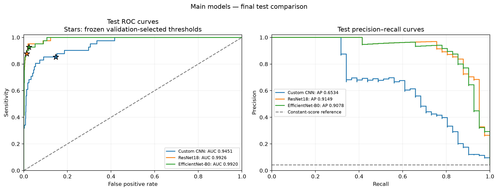
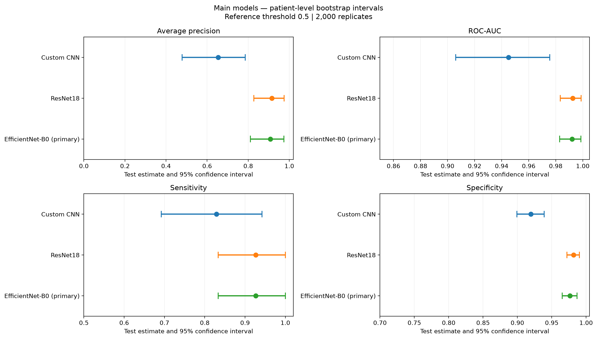

# Cataract Detection Using ODIR Fundus Images

Binary cataract detection using a Custom CNN, ImageNet-pretrained
ResNet18 and EfficientNet-B0, with patient-level splitting,
a matched negative-cohort experiment, Grad-CAM and uncertainty analysis.

## Dataset and splits

The study used eye-level annotations from the original ODIR training
spreadsheet and images. After eligibility filtering, 6,500 images
from 3,345 patients were retained.

| Split | Patients | Images | Cataract images |
|---|---:|---:|---:|
| Training | 2,341 | 4,548 | 202 |
| Validation | 502 | 979 | 44 |
| Test | 502 | 973 | 41 |

Patient, image-path and exact-pixel separation checks passed.
Near duplicates were not reliably ruled out.

Dataset: https://odir2019.grand-challenge.org/dataset/

## Final test results

Reference threshold: 0.5. Predictions were generated using checkpoints
and thresholds frozen before test evaluation.

| Model | AP | ROC-AUC | Sensitivity | Specificity | Precision | F1 | FP | FN |
|---|---:|---:|---:|---:|---:|---:|---:|---:|
| Custom CNN | 0.6534 | 0.9451 | 82.93% | 91.95% | 31.19% | 0.4533 | 75 | 7 |
| ResNet18 | 0.9149 | 0.9926 | 92.68% | 98.18% | 69.09% | 0.7917 | 17 | 3 |
| EfficientNet-B0 | 0.9078 | 0.9920 | 92.68% | 97.64% | 63.33% | 0.7525 | 22 | 3 |

EfficientNet-B0 was the primary model selected using validation AP.
ResNet18 achieved higher test point estimates, but its paired AP and
ROC-AUC intervals versus EfficientNet-B0 included zero.
Superiority or equivalence was not established.

The single-seed matched negative-cohort experiment showed operating-point
trade-offs; its paired AP improvement interval also included zero.

## Figures

## Repository contents

- `cataract_detection_odir.ipynb`: experimental notebook.
- `requirements.txt`: installed versions of the main dependencies.
- `docs/`: aggregate results, figures and experiment notes.

Data, caches, checkpoints and full generated outputs are ignored by Git.
Their absence from this repository is expected.

## Environment and reproduction

Recorded Python version: 3.13.0.
Recorded PyTorch version: 2.7.1+cu118.

Create an environment using the recorded Python version and install
the dependencies with `python -m pip install -r requirements.txt`.

Obtain the same dataset independently. Preserve the original image
layout, saved manifests, checkpoints and frozen evaluation protocol
when reproducing the saved evaluations.

The notebook documents the executed workflow. A fresh end-to-end
Run All replay has not been verified. Recovery and evaluation cells
require saved artifacts and the preceding setup definitions.

## Limitations

See [experiment notes](docs/experiment_notes.md) for the scope,
reproducibility limits and explainability qualifications.
This is an academic research project; clinical deployment was not assessed.
